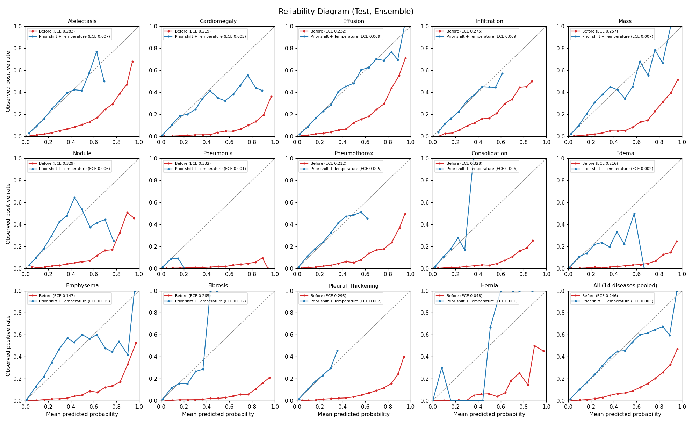

# Calibration (Reliability Diagram, ECE, Temperature Scaling)

- 데이터: 보정 추정 = 검증(OOF) 95,394장, 보고 = Test 16,724장
- ECE: 질환별 Binary ECE(15개 동일 폭 구간)의 평균. MCE: 구간 오차 최댓값의 질환 평균
- OOF 값은 Fold 교차 추정(4개 Fold로 보정 추정 → 남은 Fold에 적용)이라 과적합되지 않은 값이다.

## 방법별 비교

| 설명 | OOF ECE | OOF MCE | Test ECE | Test MCE |
| --- | --- | --- | --- | --- |
| 보정 없음 | 0.2428 | 0.6606 | 0.2457 | 0.6352 |
| Temperature (공통 T) | 0.2428 | 0.6612 | 0.2456 | 0.6355 |
| Temperature (질환별 T) | 0.2403 | 0.7060 | 0.2423 | 0.6357 |
| Prior 보정 + 질환별 T | 0.0037 | 0.3837 | 0.0048 | 0.3516 |
| Platt (질환별 a, b, 참고) | 0.0028 | 0.3440 | 0.0053 | 0.3030 |

## 선택: **Prior 보정 + 질환별 T**

선택 규칙(결과를 보기 전에 정함): Temperature 계열(질환별 T → Prior 보정 + 질환별 T) 중 OOF ECE ≤ 0.10인 첫 방법, 둘 다 넘으면 OOF ECE가 가장 낮은 방법.

| 지표 | 보정 전 | 보정 후 | 목표 |
| --- | --- | --- | --- |
| Test ECE | 0.2457 | 0.0048 | ≤ 0.1 ✓ |
| Test MCE | 0.6352 | 0.3516 | |

## 질환별 (Test)

| 질환 | 유병률(Test) | 평균 예측(보정 전) | 평균 예측(보정 후) | ECE 보정 전 | ECE 보정 후 | T |
| --- | --- | --- | --- | --- | --- | --- |
| Atelectasis | 0.1009 | 0.3840 | 0.1024 | 0.2831 | 0.0072 | 1.0389 |
| Cardiomegaly | 0.0255 | 0.2449 | 0.0288 | 0.2194 | 0.0047 | 1.0268 |
| Effusion | 0.1156 | 0.3479 | 0.1196 | 0.2323 | 0.0088 | 0.9841 |
| Infiltration | 0.1757 | 0.4510 | 0.1746 | 0.2753 | 0.0087 | 1.0148 |
| Mass | 0.0495 | 0.3069 | 0.0485 | 0.2574 | 0.0073 | 1.0890 |
| Nodule | 0.0556 | 0.3842 | 0.0541 | 0.3286 | 0.0057 | 1.0508 |
| Pneumonia | 0.0126 | 0.3441 | 0.0117 | 0.3315 | 0.0010 | 1.0404 |
| Pneumothorax | 0.0484 | 0.2601 | 0.0463 | 0.2117 | 0.0047 | 1.1189 |
| Consolidation | 0.0414 | 0.3694 | 0.0410 | 0.3280 | 0.0061 | 1.0104 |
| Edema | 0.0199 | 0.2362 | 0.0209 | 0.2163 | 0.0024 | 1.0173 |
| Emphysema | 0.0249 | 0.1719 | 0.0229 | 0.1469 | 0.0049 | 1.1955 |
| Fibrosis | 0.0168 | 0.2819 | 0.0148 | 0.2651 | 0.0024 | 1.0835 |
| Pleural_Thickening | 0.0297 | 0.3250 | 0.0298 | 0.2953 | 0.0024 | 1.0784 |
| Hernia | 0.0026 | 0.0510 | 0.0018 | 0.0484 | 0.0010 | 1.4033 |

## 해석 참고

- 학습 때 pos_weight(음성 수/양성 수)로 양성 손실을 키웠기 때문에, 모델은 logit을 약 log(pos_weight)만큼 높게 내도록 학습된다. 그래서 보정 전 평균 예측 확률이 실제 유병률보다 크게 높다(위 표 비교).
- 이 오차는 '확률을 0.5 쪽으로 모으거나 펼치는' 스케일 문제가 아니라 '전체를 위로 민' 이동 문제라서, Temperature 하나로는 다 못 고칠 수 있다. Prior 보정은 이 이동을 이론값(log pos_weight)으로 되돌린다.
- 보정은 질환별 단조 변환이라 AUROC·AUPRC(순위 지표)는 바뀌지 않는다.
- Test 최종 예측은 10개 모델 평균, OOF는 2개 모델 평균이라 확률 분포가 약간 다르다. Test ECE가 OOF ECE와 다르면 이 차이 때문일 수 있다.
