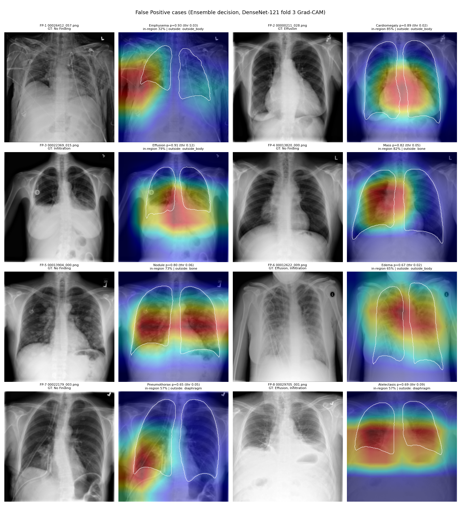
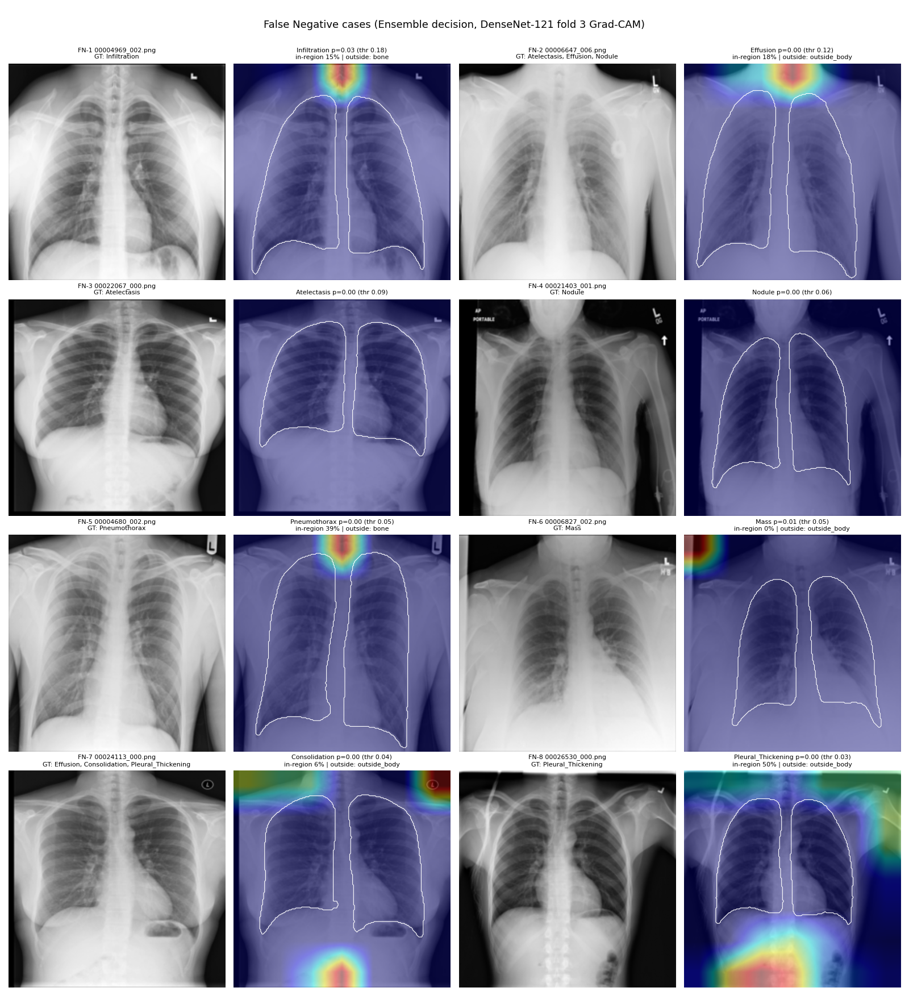
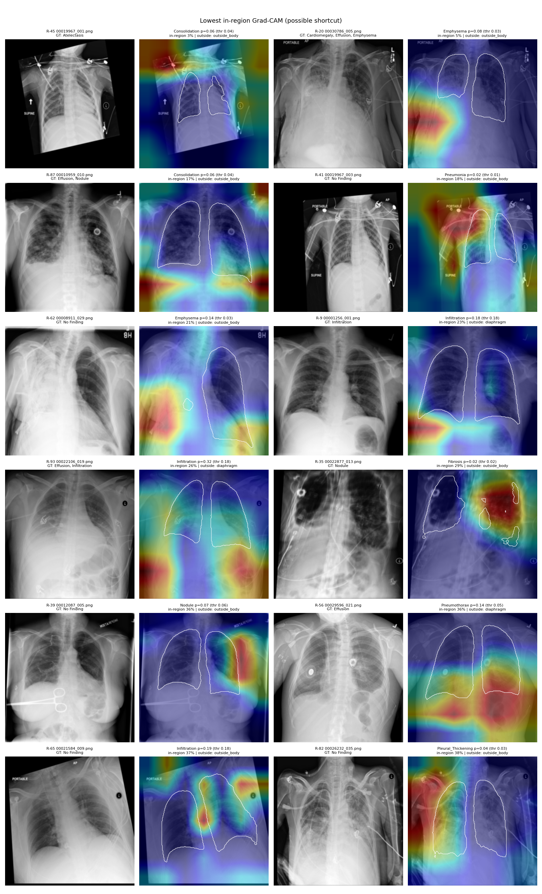

# Grad-CAM 에러 분석 (Test)

- 판정: Ensemble 보정 확률, 임계값 = youden (검증에서 정함)
- Grad-CAM: DenseNet-121 `densenet121_g0_clahe-52362096` Fold 3, 대상 레이어 `features` (마지막 Dense Block 출력, 7×7)
- 영역 비율(frac_expected): CAM 에너지 중 질환별 기대 영역(기본 폐, 경계 7px 팽창) 안 비율. 50% 미만이면 '이탈'
- 기대 영역 예외: Cardiomegaly = lung+heart, Hernia = lung+heart+mediastinum+diaphragm, Effusion = lung+diaphragm, Pleural_Thickening = lung+diaphragm, Edema = lung+heart+mediastinum
- outside_hint: 기대 영역 밖 에너지가 가장 많이 간 구조 (자동 힌트). 의료기기·텍스트는 분할 대상이 아니라 `outside_body`나 다른 구조로 잡히므로 그림을 보고 직접 판정한다.

## False Positive

| case | Image Index | disease | prob | threshold | gt_labels | frac_expected | outside_hint |
| --- | --- | --- | --- | --- | --- | --- | --- |
| FP-1 | 00026412_057.png | Emphysema | 0.93 | 0.03 | No Finding | 0.32 | outside_body |
| FP-2 | 00000211_028.png | Cardiomegaly | 0.89 | 0.02 | Effusion | 0.85 | outside_body |
| FP-3 | 00022369_015.png | Effusion | 0.91 | 0.12 | Infiltration | 0.79 | outside_body |
| FP-4 | 00013820_000.png | Mass | 0.82 | 0.05 | No Finding | 0.82 | bone |
| FP-5 | 00013904_000.png | Nodule | 0.80 | 0.06 | No Finding | 0.73 | bone |
| FP-6 | 00012622_009.png | Edema | 0.67 | 0.02 | Effusion, Infiltration | 0.65 | outside_body |
| FP-7 | 00022179_003.png | Pneumothorax | 0.65 | 0.05 | No Finding | 0.57 | diaphragm |
| FP-8 | 00029705_001.png | Atelectasis | 0.69 | 0.09 | Effusion, Infiltration | 0.57 | diaphragm |

## False Negative

| case | Image Index | disease | prob | threshold | gt_labels | frac_expected | outside_hint |
| --- | --- | --- | --- | --- | --- | --- | --- |
| FN-1 | 00004969_002.png | Infiltration | 0.03 | 0.18 | Infiltration | 0.15 | bone |
| FN-2 | 00006647_006.png | Effusion | 0.00 | 0.12 | Atelectasis, Effusion, Nodule | 0.18 | outside_body |
| FN-3 | 00022067_000.png | Atelectasis | 0.00 | 0.09 | Atelectasis | - | - |
| FN-4 | 00021403_001.png | Nodule | 0.00 | 0.06 | Nodule | - | - |
| FN-5 | 00004680_002.png | Pneumothorax | 0.00 | 0.05 | Pneumothorax | 0.39 | bone |
| FN-6 | 00006827_002.png | Mass | 0.01 | 0.05 | Mass | 0.00 | outside_body |
| FN-7 | 00024113_000.png | Consolidation | 0.00 | 0.04 | Effusion, Consolidation, Pleural_Thickening | 0.06 | outside_body |
| FN-8 | 00026530_000.png | Pleural_Thickening | 0.00 | 0.03 | Pleural_Thickening | 0.50 | outside_body |

> TODO(팀): `error_cases.csv`의 '원인', '오류 유형(모델/라벨)' 열을 그림을 보고 채운다. 분석 본문·방법 한계: [`../discussion.md`](../discussion.md) 3절.
> NIH 라벨은 판독문에서 NLP로 추출해 오류가 있다. GT 목록과 영상을 보고 '라벨 오류 가능' 사례를 구분한다.

## 폐 영역 이탈 분석

- 분석: 양성 예측 100건 (질환별로 번갈아 무작위 추출)
- 기대 영역 안 활성화: 75건 (75%)
- 이탈: 25건 (25%)
  - outside_body: 15건
  - diaphragm: 10건

| 질환 | 표본 수 | 평균 기대 영역 비율 |
| --- | --- | --- |
| Atelectasis | 8 | 0.57 |
| Cardiomegaly | 8 | 0.71 |
| Consolidation | 7 | 0.44 |
| Edema | 7 | 0.56 |
| Effusion | 7 | 0.82 |
| Emphysema | 7 | 0.45 |
| Fibrosis | 7 | 0.59 |
| Hernia | 7 | 0.77 |
| Infiltration | 7 | 0.47 |
| Mass | 7 | 0.65 |
| Nodule | 7 | 0.66 |
| Pleural_Thickening | 7 | 0.57 |
| Pneumonia | 7 | 0.53 |
| Pneumothorax | 7 | 0.55 |

## Shortcut Learning 판정

> TODO(팀): 이탈 사례 그림을 보고 `region_analysis.csv`의 'Shortcut 판정' 열을 채운다 (정리는 [`../discussion.md`](../discussion.md) 3절).
> - 의료기기(심박조율기, 튜브, 카테터)·텍스트/마커 강조 → Shortcut 의심 (질환과 함께 나타나는 표식을 학습)
> - 뼈(쇄골·늑골) 강조 → 겹친 구조의 오인 가능성
> - 개선 방향: 폐 마스킹 입력, 장비·텍스트 영역 가리기 Augmentation, 장비 유무별 성능 비교
