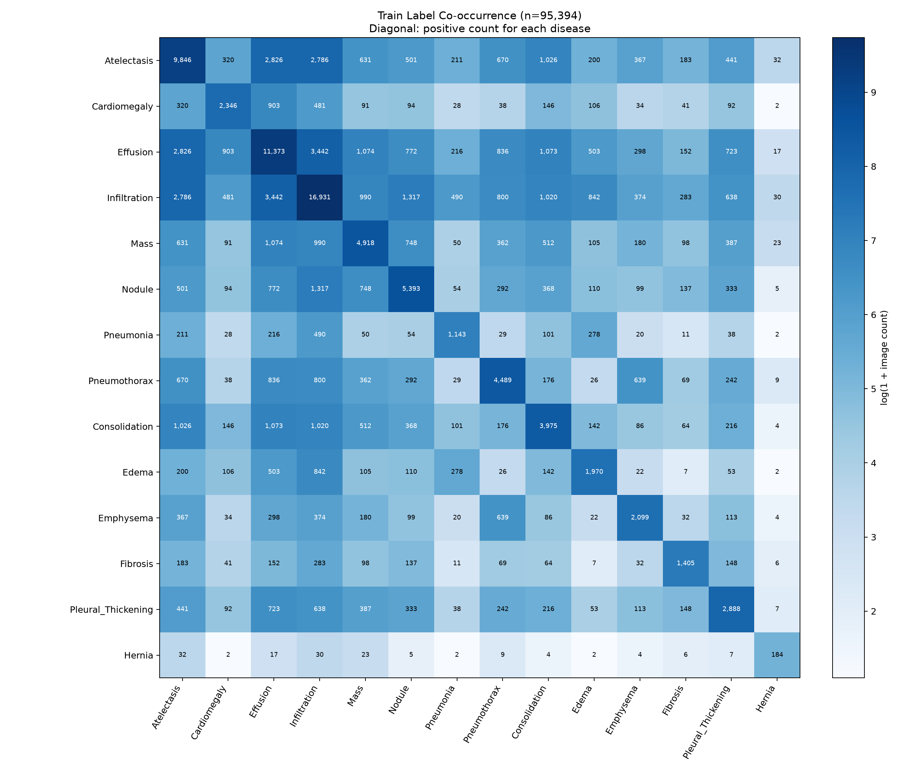
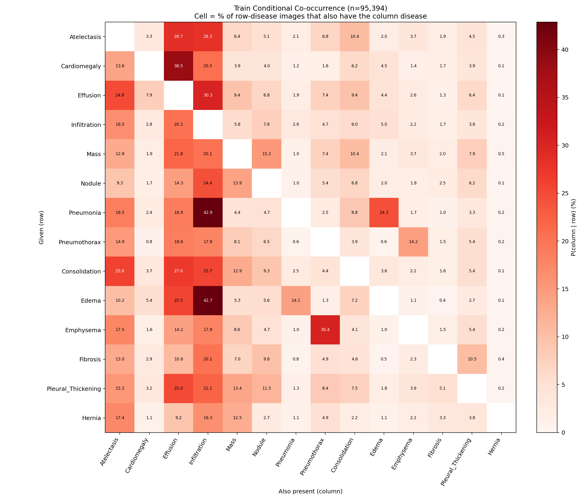
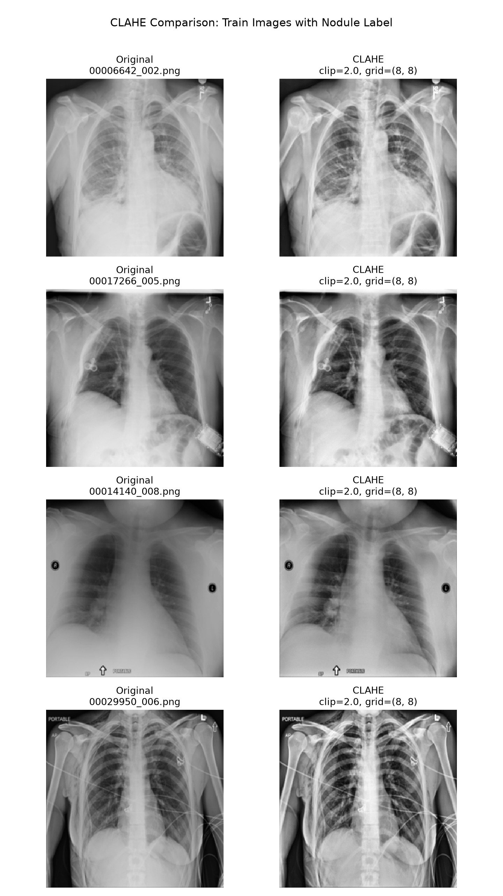
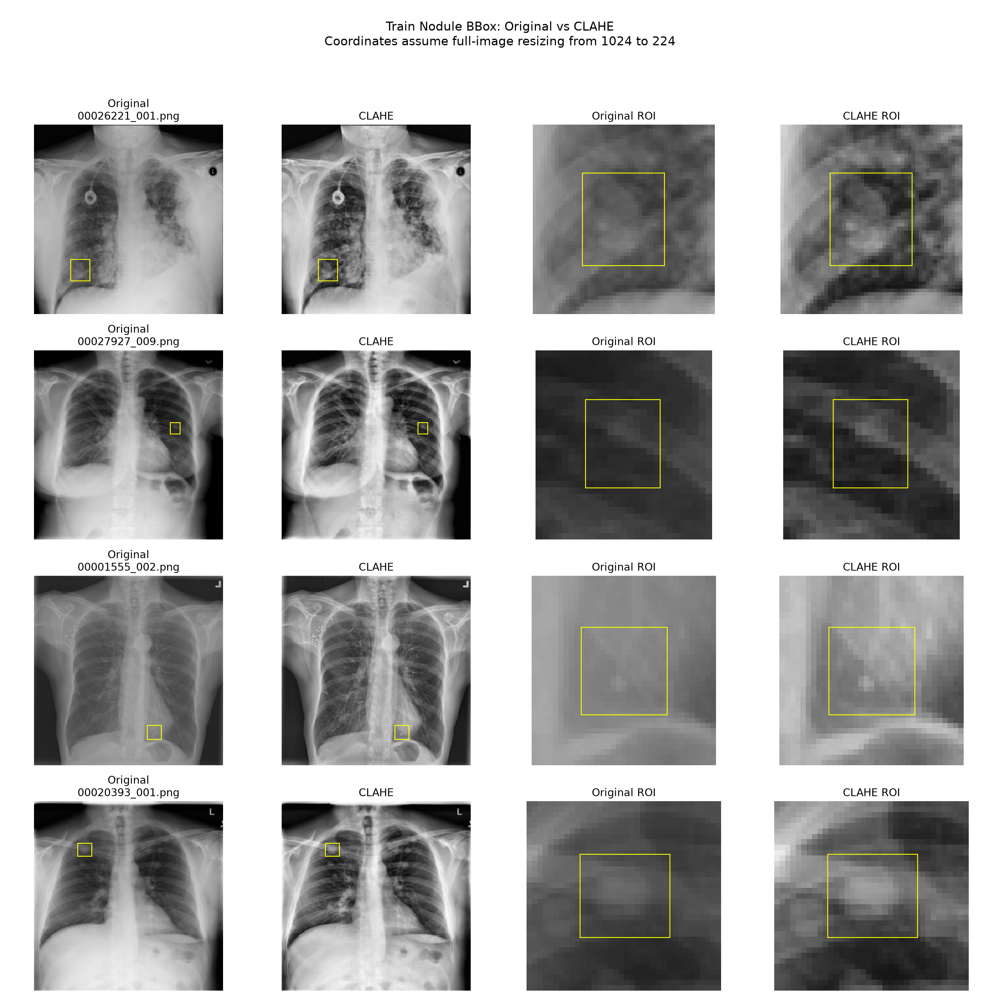
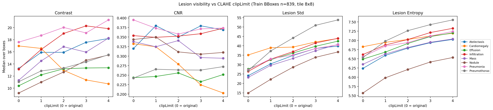

# 데이터 전처리 결과 및 재현 안내

## 1. 목적과 완료 범위

NIH ChestX-ray14 데이터의 메타데이터와 이미지 상태를 검사하고,
환자 단위로 학습·검증·최종 평가 데이터를 구분하였다.

메타데이터 처리, 이미지 검사, 품질 필터링, 환자 단위 분할,
Train 내부 Fold 배정, 질환 분포·동시 출현 분석,
CLAHE 비교, ImageNet 정규화 및 공개 DICOM 샘플 실습을 완료했다.

구조 정리 후 Windows 실제 데이터 환경에서 다음 항목의 정상 실행을 확인했다.

- RTX 4060의 CUDA 행렬 연산
- CLAHE 사용·미사용 이미지 변환
- Fold 0의 학습·검증 DataLoader
- Train 질환별 분포 및 검증 Fold별 양성 비율 요약

학습·검증 이미지 수와 질환별 분포는 구조 정리 전 결과와 일치했다.

현재는 모델 학습을 시작할 수 있도록 데이터와 입력 코드를 준비한 단계다.
모델 학습·교차검증 성능 평가 및 최종 Test 평가는 후속 단계에서 수행한다.

팀원별 모델 실험은 동일한 `fold_metadata.csv`를 기준으로 수행한다.
원본 이미지 데이터는 저장소에 포함하지 않는다.

## 2. 주요 결과

| 항목 | 결과 |
|---|---:|
| 전체 이미지 | 112,120장 |
| 고유 환자 | 30,805명 |
| 실제 이미지 파일과 연결되지 않은 메타데이터 행 | 0 |
| 메타데이터에 없는 추가 PNG | 0 |
| 이미지 읽기 실패 | 0 |
| 224×224 크기 불일치 | 0 |
| 나이 결측 | 0 |
| 나이 형식 오류 또는 허용 범위 초과 | 16 |
| 원본 전체 No Finding 이미지 | 60,412장 |
| 원본 전체에서 질환 라벨 2개 이상인 이미지 | 20,735장 |
| 품질 제외 전 Train | 95,396장 |
| Train 품질 제외 | 2장 |
| 교차검증에 사용하는 Train | 95,394장 |
| 고정 Test | 16,724장 |
| Train/Test 중복 환자 | 0명 |

## 3. 메타데이터 처리

### 나이

원본 `Patient Age`는 보존하고,
계산용 `Patient Age Years`를 별도로 생성했다.

- Y: 연 단위 그대로 사용
- M: 12로 나누어 연 단위로 환산
- D: 365.25로 나누어 연 단위로 환산
- 프로젝트 처리 기준: 0~120년
- 형식 오류 또는 범위 초과 값은 계산용 열에서 결측 처리

나이 이상치가 있다는 이유만으로 해당 이미지를 제외하지는 않았다.

### 질환 라벨

14개 질환을 각각 0 또는 1로 표현하는 Multi-hot 방식으로 변환했다.

- 한 이미지에 여러 질환이 표시될 수 있다.
- `No Finding`은 별도 보조 열로 보관한다.
- `No Finding` 이미지의 14개 질환 값은 모두 0이다.
- 모델의 질환 정답 열은 `src/constants.py`의 `DISEASES` 순서를 기준으로 한다.
- `No Finding`과 `Positive Label Count`는 모델의 14개 출력에 포함하지 않는다.
- 라벨 결측, 정의되지 않은 라벨, `No Finding`과 질환 라벨의 동시 표기는 오류로 처리한다.

여기서 0과 1은 데이터셋에 기록된 라벨을 표현하며,
임상적으로 질환 유무를 새로 판정한 결과가 아니다.

## 4. 이미지 검사 및 품질 처리

### 이미지 검사

전체 PNG의 읽기 가능 여부, 크기, 이미지 모드와 밝기 통계를 검사했다.

- L 이미지: 111,601장
- LA 이미지: 519장
- LA 이미지 519장은 알파 채널의 모든 값이 255로 완전 불투명했다.
- 완전 불투명한 LA 이미지는 밝기 채널을 사용해 처리했다.
- 전체 112,120장의 밝기 측정을 완료했다.
- 원본 이미지 파일은 수정하지 않았다.

현재 통합 이미지 검사는 불투명 LA 이미지를 직접 처리한다.
기존 `image_alpha_audit.csv`는 초기 LA 이미지 보완 검사 기록이며,
현재 전처리 실행의 필수 입력은 아니다.

### 품질 기준

| 조건 | 기준 |
|---|---|
| Too Dark | 평균 밝기 < 5 |
| Too Bright | 평균 밝기 > 250 |
| Nearly Uniform | 픽셀 밝기 표준편차 < 3 |

이는 프로젝트의 보수적인 공학적 선별 기준이며 임상 판독 기준이 아니다.
품질 후보 검토에는 Train 이미지만 사용했다.

Train에서 Too Dark와 Too Bright 해당 이미지는 없었다.
Nearly Uniform 이미지 2장을 학습·검증 대상에서 제외했다.

| 이미지 | 평균 밝기 | 밝기 표준편차 | 제외 사유 |
|---|---:|---:|---|
| 00007160_002.png | 219.700012 | 1.711951 | nearly_uniform |
| 00010007_121.png | 198.748489 | 2.227477 | nearly_uniform |

품질 플래그와 실제 제외는 구분한다.
고정 Test는 품질 플래그가 있더라도 주 평가 대상에서 임의로 제외하지 않는다.

## 5. 데이터 분할

### Train/Test 분할

Patient ID를 기준으로 GroupShuffleSplit을 사용했다.

- random_state: 42
- Test 환자 비율 설정: 15%
- Train 환자: 26,184명
- Test 환자: 4,621명
- Train/Test 중복 환자: 0명

85:15는 환자 그룹을 기준으로 한 비율이므로,
이미지 수의 비율은 정확히 85:15와 일치하지 않을 수 있다.

### Train 내부 Fold 배정

품질 검사를 통과한 Train에 5-Fold GroupKFold를 적용했다.

| Fold | 학습 이미지 | 검증 이미지 | 학습 환자 | 검증 환자 | 중복 환자 |
|---|---:|---:|---:|---:|---:|
| 0 | 76,315 | 19,079 | 20,947 | 5,237 | 0 |
| 1 | 76,315 | 19,079 | 20,947 | 5,237 | 0 |
| 2 | 76,315 | 19,079 | 20,947 | 5,237 | 0 |
| 3 | 76,315 | 19,079 | 20,947 | 5,237 | 0 |
| 4 | 76,316 | 19,078 | 20,948 | 5,236 | 0 |

각 Fold의 학습·검증 데이터에서 14개 질환 모두 양성과 음성이 존재한다.
질환별 비율이 동일하도록 보장하는 분할은 아니다.

Test와 품질 제외 Train에는 `Fold=-1`이 기록된다.
따라서 `Fold=-1`만으로 Test를 선택하면 안 된다.

Fold 배정은 완료했지만,
각 Fold의 모델 학습과 교차검증 성능 평가는 아직 수행하지 않았다.

### 후속 실험 원칙

- 팀원별 실험은 동일한 분할과 질환 출력 순서를 사용한다.
- 각 Fold는 모델을 새로 초기화하여 학습한다.
- 이전 Fold에서 학습한 가중치를 다음 Fold의 시작점으로 사용하지 않는다.
- 모델 선택, CLAHE 사용 여부 및 임계값 조정은 Train 내부 검증으로 수행한다.
- Test는 모델과 설정을 확정한 후 최종 평가에 사용한다.

## 6. 질환 분포 및 동시 출현 분석

품질 검사를 통과한 Train 95,394장을 대상으로 분석했다.

- 질환별 양성·음성 이미지 수와 양성 비율을 집계했다.
- 각 검증 Fold의 질환별 양성 비율을 비교했다.
- 14×14 질환 라벨 동시 출현 행렬과 히트맵을 생성했다.

| 결과물 | 용도 |
|---|---|
| [train_label_summary.csv](tables/train_label_summary.csv) | 질환별 양성·음성 개수와 비율 |
| [fold_label_rates.csv](tables/fold_label_rates.csv) | 검증 Fold별 질환 양성 비율 |
| [train_cooccurrence.csv](tables/train_cooccurrence.csv) | 질환 라벨 동시 출현 개수 |



대각선은 해당 질환의 양성 이미지 수다.
대각선 밖은 두 질환 라벨이 함께 표시된 이미지 수다.

색상에는 log(1 + 개수)를 사용하며, 각 칸의 숫자는 실제 개수다.
동시 출현 횟수만으로 인과관계나 연관성의 강도를 판단하지 않는다.

### 전체 데이터 기준 유병률

데이터셋 전체(112,120장, 30,805명)의 질환별 유병률을
이미지 기준과 환자 기준으로 함께 집계했다.
환자 기준은 한 번이라도 해당 라벨이 기록된 환자의 비율이다.
이 표는 데이터셋을 기술하기 위한 것이며,
모델 선택이나 임계값 결정에는 사용하지 않는다.

| 질환 | 이미지 수 | 이미지 기준 (%) | 환자 기준 (%) | Train (%) | Test (%) |
|---|---:|---:|---:|---:|---:|
| Infiltration | 19,870 | 17.72 | 26.07 | 17.75 | 17.57 |
| Effusion | 13,307 | 11.87 | 13.87 | 11.92 | 11.56 |
| Atelectasis | 11,535 | 10.29 | 16.15 | 10.32 | 10.09 |
| Nodule | 6,323 | 5.64 | 11.00 | 5.65 | 5.56 |
| Mass | 5,746 | 5.12 | 8.28 | 5.16 | 4.95 |
| Pneumothorax | 5,298 | 4.73 | 4.82 | 4.71 | 4.84 |
| Consolidation | 4,667 | 4.16 | 6.98 | 4.17 | 4.14 |
| Pleural_Thickening | 3,385 | 3.02 | 6.51 | 3.03 | 2.97 |
| Cardiomegaly | 2,772 | 2.47 | 5.08 | 2.46 | 2.55 |
| Emphysema | 2,516 | 2.24 | 3.40 | 2.20 | 2.49 |
| Edema | 2,303 | 2.05 | 3.48 | 2.07 | 1.99 |
| Fibrosis | 1,686 | 1.50 | 4.09 | 1.47 | 1.68 |
| Pneumonia | 1,353 | 1.21 | 3.10 | 1.20 | 1.26 |
| Hernia | 227 | 0.20 | 0.43 | 0.19 | 0.26 |
| No Finding | 60,412 | 53.88 | 80.87 | 53.87 | 53.97 |

- 가장 흔한 질환과 가장 드문 질환의 유병률은 약 89배 차이 난다.
- Train과 Test의 질환별 유병률 차이는 최대 0.36%p다.
- Train은 품질 검사를 통과한 95,394장, Test는 16,724장 기준이다.

### 조건부 동시 출현

개수 행렬은 흔한 질환이 색을 지배하므로,
각 행을 해당 질환의 양성 수로 나눈 조건부 비율도 계산했다.
칸의 값은 행 질환이 있는 이미지 중 열 질환도 함께 표시된 비율(%)이다.



- Pneumonia 이미지의 42.9%, Edema 이미지의 42.7%에 Infiltration이 함께 표시됐다.
- Cardiomegaly 이미지의 38.5%에 Effusion, Emphysema 이미지의 30.4%에 Pneumothorax가 함께 표시됐다.
- 다른 질환 없이 단독으로 표시된 비율은 Pneumonia 22.0%, Edema 27.8%, Consolidation 28.8%로 낮다.

모델이 병변 자체보다 함께 표시되는 소견의 패턴을 학습할 수 있으므로,
질환별 성능은 동반 질환 유무를 나누어 확인할 필요가 있다.
조건부 비율 역시 연관성을 기술할 뿐 인과관계를 뜻하지 않는다.

| 결과물 | 용도 |
|---|---|
| [dataset_prevalence.csv](tables/dataset_prevalence.csv) | 전체 데이터 이미지·환자 기준 유병률 및 Train/Test 비교 |
| [train_conditional_cooccurrence.csv](tables/train_conditional_cooccurrence.csv) | 조건부 동시 출현 비율 |

## 7. CLAHE 적용 전후 비교

### 비교 방법

- 설정: clipLimit=2.0, tileGridSize=(8, 8)
- 품질 검사를 통과한 Train에서만 비교 대상을 선정했다.
- 전체 영상 비교: Nodule 라벨이 있는 유효 Train에서 환자별 후보 이미지 하나를 정한 후 서로 다른 환자 4명을 선정했다.
- BBox 영역 비교: Nodule BBox가 있는 고유 Train 환자 65명 중 서로 다른 환자 4명을 선정했다.
- 두 비교 모두 random_state=42를 사용했다.
- 각 비교의 대상 이미지는 별도 CSV에 기록했다.
- 모든 영상은 동일한 밝기 표시 범위인 0~255를 사용했다.
- 원본 이미지 파일은 수정하지 않았다.

BBox 비교에서는 NIH의 1024×1024 기준 좌표를 224×224에 맞게 환산했다.
이는 전체 영상이 자르기 없이 축소됐다는 전제에 따른다.

전체 영상에 CLAHE를 적용한 다음,
원본과 처리 결과에서 동일한 BBox 주변 영역을 잘라 비교했다.

### 비교 그림

전체 영상 비교:



BBox 및 관심 영역 비교:



BBox 비교 그림의 노란 사각형은 데이터셋의 Nodule 주석이며
모델 예측 결과가 아니다.

### 관찰 결과

일부 예시에서는 주석 영역 내부의 밝은 부분과 주변 배경의
명암 차이가 증가하여 시각적으로 구분하기 쉬워졌다.

그러나 모든 예시에서 대상이 명확해진 것은 아니며,
주변 구조와 영상의 거친 질감도 함께 강조됐다.

### 정량 비교

정성 비교를 보완하기 위해, 품질 검사를 통과한 Train의
전체 BBox 839개(이미지 749장, 8개 질환)에 대해
병변 영역과 주변 영역의 지표를 CLAHE 전후로 측정했다.
Test 이미지의 BBox는 사용하지 않았다.

| 지표 | 정의 | 의미 |
|---|---|---|
| Contrast | 병변 평균 밝기와 주변 평균 밝기의 차이(절댓값) | 병변이 주변과 구분되는 정도 |
| CNR | Contrast / 주변 밝기 표준편차 | 노이즈 대비 병변 신호. 노이즈가 함께 커지면 증가하지 않는다 |
| Lesion Std | 병변 내부 밝기 표준편차 | 병변 내부 구조의 선명도 |
| Lesion Entropy | 병변 내부 밝기 분포의 엔트로피 | 병변 내부 정보량 |

주변 영역은 BBox를 긴 변의 0.5배만큼 넓힌 테두리 영역이다.
값은 같은 BBox의 원본 대비 변화율이며, 표에는 BBox별 변화율의 중앙값을 적었다.

| clipLimit | Contrast | CNR | Lesion Std | Lesion Entropy |
|---:|---:|---:|---:|---:|
| 1.0 | +12.9% | −0.3% | +23.7% | +4.4% |
| **2.0** | **+14.2%** | **−2.1%** | **+38.8%** | **+7.5%** |
| 3.0 | +16.5% | −5.4% | +50.7% | +9.4% |
| 4.0 | +16.8% | −4.2% | +59.9% | +10.7% |

| 질환 (clipLimit=2.0) | BBox | Contrast | CNR | Lesion Std |
|---|---:|---:|---:|---:|
| Nodule | 66 | +46.8% | +2.2% | +92.7% |
| Mass | 74 | +38.3% | −2.0% | +53.4% |
| Infiltration | 112 | +31.0% | +9.5% | +37.5% |
| Pneumothorax | 84 | +21.1% | +2.6% | +66.9% |
| Atelectasis | 159 | +17.5% | −1.7% | +42.4% |
| Pneumonia | 103 | +14.7% | +8.0% | +26.8% |
| Effusion | 128 | +12.1% | +4.8% | +34.0% |
| Cardiomegaly | 113 | −22.7% | −26.9% | +12.0% |



- 병변과 주변의 밝기 차이와 병변 내부 구조는 CLAHE 적용 후 커졌다. Nodule과 Mass에서 가장 컸다.
- 전체 CNR은 거의 변하지 않거나 약간 감소했다. 병변 신호와 함께 주변 노이즈도 증폭되기 때문이다.
- clipLimit이 클수록 대비는 조금 더 커지지만 CNR 감소도 커진다.
  현재 설정 2.0은 대비 개선이 3.0·4.0과 비슷하면서 CNR 감소가 작다.
- Cardiomegaly처럼 큰 구조물은 타일 단위 평활화로 주변과의 차이가 오히려 줄었다.

이 결과는 영상 지표상의 시인성 변화이며 모델 성능 향상을 뜻하지 않는다.
CLAHE 사용 여부는 기존 원칙대로 교차검증 성능 비교로 결정한다.

### 해석의 한계

- 그림 비교는 4개 예시에 대한 정성적 관찰이며, 정량 비교는 BBox 영역의 밝기 통계만 측정한다.
- 224×224 영상의 확대는 소실된 세부 정보를 복원하지 않는다.
- BBox 위치의 정확성은 다운로드 데이터의 기하학적 변환 방식에 의존한다.
- 임상적 검출 능력이나 모델 성능 향상을 입증한 결과는 아니다.
- 모델 성능에 미치는 영향은 이후 동일한 분할을 사용한 교차검증으로 평가해야 한다.

### 재현 자료

- 전체 영상 비교: `src/analysis/compare_clahe.py`
- BBox 비교: `src/analysis/compare_clahe_bbox.py`
- BBox 정량 비교: `src/analysis/measure_clahe_bbox.py`
- [clipLimit별 전체·질환별 요약](tables/clahe_bbox_metric_summary.csv) (`Scope=All`은 전체, 나머지는 질환명)
- [전체 영상 비교 대상·설정](tables/clahe_samples.csv)
- [BBox 비교 대상·좌표·설정](tables/clahe_bbox_samples.csv)

## 8. 모델 입력 변환 및 DataLoader

### 이미지 변환

`src/data/image_transforms.py`에서 다음 처리를 수행한다.

1. 이미지 로드 및 지원 모드 확인
2. LA 이미지의 완전 불투명 여부 확인
3. 회색조 변환
4. 필요한 경우 전체 영상을 224×224로 조정
5. 선택적 CLAHE 적용
6. 픽셀 값을 float32의 0~1 범위로 변환
7. 회색조 채널을 복제해 3채널 구성
8. ImageNet 평균·표준편차로 정규화

이미 224×224인 영상은 크기를 다시 조정하지 않는다.
이미지 파일을 일괄 덮어쓰지 않고, 데이터를 읽을 때 변환한다.

| 항목 | 설정 |
|---|---|
| 입력 크기 | 224×224 |
| 채널 수 | 3 |
| 자료형 | torch.float32 |
| ImageNet 평균 | (0.485, 0.456, 0.406) |
| ImageNet 표준편차 | (0.229, 0.224, 0.225) |

정규화 이후 텐서 값은 0~1 범위로 제한되지 않는다.

CLAHE 사용·미사용 변환을 모두 점검했다.
CLAHE 사용 여부의 최종 선택은 후속 모델 성능 비교에서 결정한다.

### Dataset 및 배치

`src/data/chest_xray_dataset.py`가 메타데이터의 이미지 경로와
14개 질환 정답을 연결한다.

- 이미지는 요청받을 때 한 장씩 읽는다.
- 질환 정답은 `src/constants.py`의 `DISEASES` 순서를 따른다.
- 학습·검증 데이터 선택 시 환자 중복 여부를 확인한다.

구조 정리 후 Fold 0의 학습·검증 각 한 배치에서 다음을 확인했다.

| 항목 | 결과 |
|---|---|
| 학습 Dataset | 76,315장 |
| 검증 Dataset | 19,079장 |
| 이미지 배치 | (8, 3, 224, 224) |
| 정답 배치 | (8, 14) |
| 이미지·정답 장치 | cuda:0 |
| 검사 결과 | 정상 |

이 점검은 데이터 입력 연결을 확인한 것이며,
모델 학습이나 전체 데이터에 대한 추론을 수행한 결과는 아니다.

## 9. DICOM 샘플 처리 실습

### 대상과 목적

pydicom 3.0.2의 공개 테스트 샘플 `CT_small.dcm`을 사용했다.

DICOM의 메타데이터 접근, 픽셀 추출 및 식별 관련 태그 제거를
실습하기 위한 자료이며, NIH 흉부 X-ray 학습 데이터에는 포함하지 않았다.

### 파싱 결과

| 항목 | 결과 |
|---|---|
| 촬영 방식 | CT |
| 영상 크기 | 128×128 |
| 픽셀 자료형 | int16 |
| Photometric Interpretation | MONOCHROME2 |
| Transfer Syntax | Explicit VR Little Endian |
| 저장 픽셀 범위 | 128~2191 |

### 메타데이터 제거 결과

원본을 메모리에 복사한 뒤,
샘플의 영상 처리에 필요한 허용 목록에 없는 태그를 제거했다.

식별 관련 필드의 실제 값은 출력하지 않았다.

| 항목 | 결과 |
|---|---|
| 최상위 태그 수 | 258 → 14 |
| Private 태그 수 | 179 → 0 |
| 확인 대상 식별 관련 태그 | 모두 제거 |
| 처리 전후 픽셀 값 | 동일 |
| 원본 파일 수정 | 수행하지 않음 |
| 처리된 DICOM·영상 파일 저장 | 수행하지 않음 |

Private 태그가 모두 개인정보를 의미하는 것은 아니지만,
이번 실습에서는 보수적으로 제거했다.

검사 결과 요약은 [dicom_sample_audit.json](tables/dicom_sample_audit.json)에 기록한다.

### 로컬 영상 확인

메타데이터의 Modality LUT 또는 Rescale 정보를 반영한 후,
전체 값 범위 및 제한된 표시 범위로 샘플 영상을 확인했다.

표시한 영상에서 이름·환자번호·날짜 등의 식별 문자는
육안으로 관찰되지 않았다. 영상은 파일로 저장하지 않았다.

JSON의 `pixel_identifiers_reviewed: false`는
스크립트가 픽셀 내 식별 문자 검사를 수행하지 않았음을 뜻한다.
육안 관찰 기록과 자동 검증 결과를 구분한다.

### 범위와 한계

본 작업은 특정 공개 테스트 샘플에 대한 파싱·태그 제거 실습이다.
범용 DICOM 비식별화 도구나 DICOM 비식별화 표준 준수 검증을
구현한 것은 아니다.

육안 확인만으로 픽셀 내 식별 정보의 부재를 완전히 보장하지 않는다.
따라서 완전한 비식별화 검증 상태는 미완료로 유지한다.

필수 UID 등도 제거하므로 처리 객체를 의료 시스템에서 사용할
DICOM 파일로 저장하는 용도로 사용하지 않는다.

## 10. 공유 파일 및 코드 안내

### 학습 기준 및 검사 기록

| 파일 | 용도 |
|---|---|
| [fold_metadata.csv](../../data/processed/fold_metadata.csv) | 정답·경로·Split·Fold를 포함한 공통 목록 |
| [excluded_train_images.csv](../../data/processed/excluded_train_images.csv) | Train 품질 제외 목록 |
| [image_quality_audit.csv](../../data/processed/image_quality_audit.csv) | 이미지 읽기·크기·모드·밝기 검사 기록 |
| [image_alpha_audit.csv](../../data/processed/image_alpha_audit.csv) | 초기 LA 이미지 투명도 검사 기록 |
| [fold_summary.csv](tables/fold_summary.csv) | Fold별 이미지·환자 수 및 중복 수 |

`split_metadata.csv`와 `quality_metadata.csv`는 처리 과정의 중간 결과다.
팀원별 모델 실험의 공통 기준은 최종 `fold_metadata.csv`다.

### 코드 역할

아래 경로는 저장소 루트를 기준으로 한다.

| 경로 | 역할 |
|---|---|
| `src/constants.py` | 14개 질환 정답 순서 |
| `src/paths.py` | 프로젝트 기준 경로 |
| `src/preprocessing/prepare_training_data.py` | 메타데이터 처리·이미지 검사·품질 표시·환자 분할·Fold 배정 |
| `src/analysis/review_image_quality.py` | Train 밝기·대비 검토 후보 그림 생성 |
| `src/analysis/summarize_labels.py` | 질환별 개수와 Fold별 비율 집계 |
| `src/analysis/plot_cooccurrence.py` | 동시 출현 행렬 및 히트맵 생성 |
| `src/analysis/compare_clahe.py` | CLAHE 전체 영상 비교 |
| `src/analysis/compare_clahe_bbox.py` | CLAHE BBox 영역 비교 |
| `src/analysis/measure_clahe_bbox.py` | CLAHE BBox 영역 지표 정량 비교 |
| `src/analysis/summarize_prevalence.py` | 전체 데이터 이미지·환자 기준 유병률 |
| `src/analysis/plot_conditional_cooccurrence.py` | 조건부 동시 출현 비율 및 히트맵 |
| `src/data/image_transforms.py` | 모델 입력 이미지 변환 |
| `src/data/chest_xray_dataset.py` | 이미지·정답 연결 및 Fold 선택 |
| `src/dicom/inspect_dicom.py` | DICOM 메타데이터 및 픽셀 파싱 |
| `src/dicom/deidentify_dicom_sample.py` | 샘플 식별 태그 제거 및 검사 |
| `src/dicom/view_dicom_sample.py` | DICOM 샘플 로컬 영상 표시 |
| `scripts/checks/` | GPU·이미지 변환·DataLoader 점검 |
| `legacy/` | 초기 구현 및 일회성 보완 작업 기록 |

`legacy/`의 코드는 현재 파이프라인에서 실행하지 않는다.

## 11. 팀원 사용 방법 및 재현 절차

### 데이터 배치

저장소 루트를 기준으로 다음 위치에 원본 데이터를 준비한다.

- 메타데이터: `data/raw/Data_Entry_2017.csv`
- 이미지 예시: `data/raw/images/images-224/00000001_000.png`
- BBox 비교용 주석: `data/raw/BBox_List_2017_Official_NIH.csv`

`fold_metadata.csv`의 `Image Path`는 `data/raw/` 기준 상대 경로다.

공유된 결과물을 사용하는 팀원은 전체 이미지 검사를 다시 수행하지 않고
공통 메타데이터를 읽어 모델 입력을 구성할 수 있다.
자신의 이미지 파일이 해당 경로에 존재하는지는 확인해야 한다.

### Fold 선택 예시

다음 코드는 저장소 루트에서 실행하는 경우를 기준으로 한다.

```python
from pathlib import Path

import pandas as pd

df = pd.read_csv(
    "data/processed/fold_metadata.csv",
    low_memory=False,
)

k = 0

eligible_train = df["Split"].eq("train") & df["Fold"].ge(0)

train_df = df.loc[
    eligible_train & df["Fold"].ne(k)
].copy()

val_df = df.loc[
    eligible_train & df["Fold"].eq(k)
].copy()

test_df = df.loc[df["Split"].eq("test")].copy()

image_path = (
    Path("data/raw") / train_df.iloc[0]["Image Path"]
)
```

`Fold != k` 조건만 사용하면 Test와 제외 이미지까지 포함될 수 있으므로,
반드시 Train 및 유효 Fold 조건을 함께 적용한다.

### 실행 위치와 방식

모든 명령은 프로젝트 루트에서 실행한다.
파일 경로 직접 실행 대신 `-m`을 사용하는 모듈 실행 방식으로 통일한다.

아래 명령은 기존 Windows `.venv` 환경을 기준으로 한다.

### 학습 입력 점검

원본 이미지와 공유된 `fold_metadata.csv`가 있다면
다음 명령으로 입력 연결을 확인할 수 있다.

```powershell
.\.venv\Scripts\python.exe -m scripts.checks.check_torch
.\.venv\Scripts\python.exe -m scripts.checks.check_image_transforms
.\.venv\Scripts\python.exe -m scripts.checks.check_dataloader
```

### 전처리 실행

```powershell
.\.venv\Scripts\python.exe -m src.preprocessing.prepare_training_data
```

- 검사 CSV가 없으면 전체 이미지를 읽어 검사표를 생성한다.
- 검사 CSV가 있으면 대상 파일명·경로·읽기 성공·크기·밝기 측정값을 확인하고 재사용한다.
- 동일한 이름과 경로로 이미지 내용만 교체한 경우는 캐시 확인으로 감지하지 못한다.
- 기존 환자 분할이나 Fold가 달라지면 중단한다.

원본 이미지를 교체했거나 전체 재검사가 필요한 경우에만 다음 옵션을 사용한다.

```powershell
.\.venv\Scripts\python.exe -m src.preprocessing.prepare_training_data --refresh-image-audit
```

기존 분할과 다른 결과가 감지되면 원인을 확인한다.
오류를 없애기 위해 기존 분할 파일을 임의로 삭제하지 않는다.

### 분석 결과 재생성

```powershell
.\.venv\Scripts\python.exe -m src.analysis.summarize_labels
.\.venv\Scripts\python.exe -m src.analysis.plot_cooccurrence
.\.venv\Scripts\python.exe -m src.analysis.review_image_quality
.\.venv\Scripts\python.exe -m src.analysis.compare_clahe
.\.venv\Scripts\python.exe -m src.analysis.compare_clahe_bbox
.\.venv\Scripts\python.exe -m src.analysis.measure_clahe_bbox
.\.venv\Scripts\python.exe -m src.analysis.summarize_prevalence
.\.venv\Scripts\python.exe -m src.analysis.plot_conditional_cooccurrence
```

표는 `reports/preprocessing/tables/`,
그림은 `reports/preprocessing/figures/`에 저장한다.

품질 후보 검토는 제외된 2장을 포함한 전체 Train을 대상으로 한다.
CLAHE 비교는 품질 기준을 통과한 Train을 대상으로 한다.

### DICOM 샘플 실습

```powershell
.\.venv\Scripts\python.exe -m src.dicom.inspect_dicom
.\.venv\Scripts\python.exe -m src.dicom.deidentify_dicom_sample
.\.venv\Scripts\python.exe -m src.dicom.view_dicom_sample
```

## 12. 전처리 완료 현황

### 완료한 전처리 작업

- [x] 메타데이터 로드 및 나이 결측·이상값 처리
- [x] 14개 질환 Multi-hot 인코딩 및 No Finding 분리
- [x] 이미지 파일 매칭·읽기·크기·모드·밝기 검사
- [x] 불투명 LA 이미지 처리
- [x] Train 품질 제외 기준 적용 및 제외 목록 기록
- [x] 환자 기준 Train/Test 분할 및 중복 확인
- [x] Train 내부 5-Fold 배정 및 질환별 양성·음성 확인
- [x] 질환 분포 표 및 동시 출현 히트맵 생성
- [x] CLAHE 전체 영상·BBox 영역 비교 및 문서화
- [x] CLAHE BBox 영역 정량 비교 (Train BBox 839개)
- [x] 전체 데이터 이미지·환자 기준 유병률 표
- [x] 조건부 동시 출현 히트맵 및 단독 표시 비율
- [x] 모델 입력 변환 및 ImageNet 정규화
- [x] 공개 DICOM 샘플 파싱·식별 태그 제거 실습 및 로컬 영상 확인
